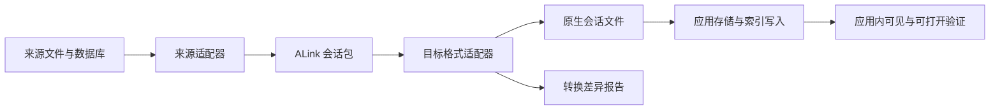

> dsh-alink 沿用本文的 ALink 0.1.0 归档格式；当前迁移范围与来源有效性要求以 [README](../README.md) 为准。

# ALink 会话中间格式 v0.1

状态：**已实现并通过样本验证的实验草案**。这是一份会话存储与转换规范，不定义 Agent 通信协议，也不执行会话中的工具或指令。

## 目标与保证范围

格式需要同时做到：提供应用无关的消息/事件表示；保留来源特有记录；携带可取得的关联资源；明确无法收集或无法映射的部分。

必须区分：

1. **记录保真**：已收集的原文件和数据库行可完整保存。
2. **语义映射**：某类数据已被转换为通用字段，其他应用适配器可以理解。
3. **资源完整**：会话引用的文件、Blob 和外部历史片段已收集齐全。
4. **目标接纳**：目标应用能够识别输出、列出会话并正确展示。

v0.1 的校验器检查格式、内容哈希和内部引用；它不会把校验通过解释成上述四项全部完成。当前适配器仍有明确的数据收集与语义映射缺口。

## 会话包结构

一份 `.alink` 目录对应一次会话捕获。桌面版可把该目录内容封装为 `.alink.zip`；内部结构与 v0.1 保持一致。转换下载包还包含 `candidate/` 和 `original.alink/`，后者可再次导入。

```text
example.alink/
  manifest.json       会话、来源、资源清单、完整性信息和问题清单
  events.jsonl        通用事件视图
  records.jsonl       带来源定位的原始记录
  objects/
    <sha256>          原文件、附件或其他二进制对象
```

原文件和资源按 SHA-256 保存。事件流与原始记录流分开，避免为了读一条消息就加载全部附件；长历史不必被塞进单个 JSON 数组。当前候选导出器仍会将事件视图加载到内存，尚未完成大文件流式导出优化。

直接可运行的 [合成会话包](../examples/demo.alink/manifest.json) 来自 [合成 WorkBuddy 记录](../examples/workbuddy-session.jsonl)，不包含用户真实会话。

## manifest.json

机器可校验的定义：[manifest schema](../schemas/manifest.json)。

| 字段 | 意义 |
|---|---|
| `id` | ALink 捕获包 UUID；与来源会话 ID 分开 |
| `format` | 固定为 `alink.session` |
| `version` | 本版固定为 `0.1.0` |
| `captured_at` | 捕获时间，不冒充会话创建时间 |
| `source.app` | 来源应用，如 `workbuddy`、`codex`、`dsh`、`raccoon`、`cursor` |
| `source.native_format` | 被读取的具体格式，如 `rollout-jsonl`、`session-v0-jsonl` |
| `source.location` | 可选的原存储位置，只作来源证据 |
| `source.app_version` | 可选安装版本；不确定时不编造 |
| `session` | 可提取的来源 ID、标题、工作目录、创建/更新时间等会话元信息 |
| `session.project` | 可选项目描述：`name`、`path`、`kind`（directory / remote / workspace_file），以及可选原生 `native_id` 和 `uri` |
| `streams` | 本包两个固定流文件的名称 |
| `resources` | 资源、可用性和对象引用 |
| `original_files` | 精确保留的原文件名、哈希、字节数及对象位置 |
| `coverage` | 实际收集的原始记录数、通用事件数与事件类型计数 |
| `issues` | 收集、关联或语义解释中的已知缺口 |
| `integrity` | 两个流文件的 SHA-256 和字节数 |

桌面版 0.3 保留 `session.cwd` 的兼容性，并添加可选 `session.project`，无需变更包版本。来源索引中的工作目录与 Cursor 的 workspaceIdentifier 会进入该描述；导入时通过路径建立目标原生关联，不能把来源应用的项目 ID 直接当成另一个应用的项目 ID。目标目录的改选记录在安装凭据 `project` 中，来源包保持不变。项目路径不表示整个目录已被复制，附件覆盖仍以资源清单为准。

`session` 不是原始数据的唯一归宿。完整原生会话行仍在 `records.jsonl` 中；通用字段提取不会删除模型设置、插件信息、未知扩展等来源内容。

这些计数表示**已收集的输入范围**，不是“该应用全部数据已收集”的宣言。来自多个数据库和日志的快照若不能保证同一时刻，需要在 `issues` 中说明。

## records.jsonl：原始证据

机器定义：[record schema](../schemas/record.json)。每行是：

```json
{"id":"r0","locator":{"file":"conversation.jsonl","record_index":0},"value":{"type":"message","id":"source-message-id","future_field":null}}
```

- `id` 在包内为 `r0`、`r1`……，稳定指向本次捕获的一条记录。
- `locator` 描述原文件、记录序号，或数据库、表、键。`record_index` 是解析记录序号，不冒充物理行号。
- `value` 保存完整来源值。未知字段、`null`、空数组、空对象、零和 `false` 都不因归一化而删除。
- SQLite 行保留原列名与值；其中 BLOB 使用 `{"$binary":"...","encoding":"base64"}` 明确标记。原本储存为 JSON 字符串的列仍保留字符串，避免二次编码改变原值。
- JSONL 原文件另外进入 `objects/`，能够还原原字节、空白、换行和数值字面形式。不要将重新序列化的 JSON 称为字节级还原。
- 对数据库只抽取相关会话行，而非把其他会话和全局账号设置一起复制。相关表定义可以作为带 `kind: schema` 来源定位的记录保存。

原始记录是格式扩展的基础：尚不理解的新事件仍有完整保存位置。**保留了原始字段，不等于已经实现了该字段的跨应用语义转换。**

## events.jsonl：通用视图

机器定义：[event schema](../schemas/event.json)。

```json
{"id":"e0","seq":0,"kind":"message","record_ref":"r0","role":"user","native_type":"message","native_id":"source-message-id","content":[{"type":"text","text":"原始正文\n保留换行"}]}
```

| 字段 | 规则 |
|---|---|
| `id`、`seq` | 包内唯一事件 ID 和连续导入序号；不拿时间戳替代来源确定的顺序 |
| `record_ref` | 必须指向本包的一条原始记录；同一原始记录可以产生多个通用事件 |
| `kind` | 下表定义的事件类别 |
| `role` | 保留语义角色，包括 user、assistant、system、developer、tool；未知角色不伪装成熟悉角色 |
| `content` | 有序内容块数组，不将结构化内容强制拼成一段文本 |
| `native_type`、`native_id` | 原始类型和标识，方便定位与适配 |
| `parent_native_id` | 来源记录的父引用，不擅自推断成简单线性对话 |
| `turn_id` | 来源可确定的轮次标识 |
| `timestamp` | 本轮已支持来源中的 ISO 时间或毫秒时间；原值同时留在原始记录 |
| `projection` | `display`、`context` 或 `auxiliary`，区分正文、上下文和辅助记录 |
| `visible`、`active` | 来源明确提供时保留；不能把被隐藏/替换的历史自动混进活动消息 |

本版支持的事件类别：

| 类别 | 意义 | 当前通用解释程度 |
|---|---|---|
| `message` | 用户/助手及其他角色消息 | 已归一化角色与文本/资源块 |
| `reasoning` | 来源实际保存的推理展示内容或摘要 | 部分来源已映射；不透明字段留在原记录 |
| `tool_call`、`tool_result` | 工具调用与结果 | WorkBuddy/Codex 和部分 Cursor 记录已映射 ID、参数、结果 |
| `artifact` | 关联或生成的文件、资源 | 支持资源引用与字节保存 |
| `checkpoint` | 文件历史、变更集、检查点 | 已分类并保留原记录，尚未统一所有差异算法 |
| `compaction` | 摘要替换、压缩边界 | 保留原始替换关系；尚未统一重建所有应用的有效上下文 |
| `plan` | 计划、待办条目 | 分类保留，原生卡片结构尚未全面归一化 |
| `usage` | Token、缓存、费用等记录 | 分类保留，计量字段主要仍在原始记录 |
| `metadata`、`lifecycle` | 会话设置、展示投影、开始/结束/进度等 | 分类保存，并避免重复生成正文 |
| `opaque` | 尚不能解释的事件 | 原样保留，不能当作成功转换的正文 |

通用工具内容块示例：

```json
{"type":"tool_call","call_id":"call-1","name":"write_note","arguments":"{\"text\":\"原文\"}","argument_encoding":"json_string"}
```

```json
{"type":"tool_result","call_id":"call-1","name":"write_note","output":{"type":"text","text":"完成"},"status":"completed"}
```

调用参数保留原始字符串。`argument_encoding: text` 表示自由文本工具；不能自动改成 JSON 参数工具。结果的 `output` 可以是 JSON 值，不必先转成文本。父关系、来源事件范围、复杂分支、run/step 关系等若超出当前通用字段，会留在原记录并标明解释缺口。

Cursor 的活动消息按 Header 顺序导入，其他关联记录可以追加保存；这部分 `seq` 只表示捕获顺序，不声称是不可确定的真实生成顺序。

## 资源与中间产物

内容块引用 `resources` 中的 ID：

```json
{"type":"resource","resource_id":"a0","native_type":"file"}
```

资源记录包含来源 URI、原记录引用，以及以下状态之一：

| `status` | 含义 |
|---|---|
| `embedded` | 字节已存入本包，必须带哈希、字节数和对象路径 |
| `external` | 原位置已知，但本轮未收集，或是目录/其他原生引用 |
| `remote` | HTTP(S) 地址；本轮未自动下载 |
| `missing` | 已允许检查的本地文件确实不存在 |

相同内容可以共用一个对象；不同来源 URI 和引用关系仍应保留。对象的落盘位置必须是 `objects/<sha256>`，不能把来源路径当作待写入目标路径。

本版已经收集 WorkBuddy 的已关联产物、小浣熊的文件与任务输出，并能保存内联二进制。当前还未完整解决 Cursor 共享 Blob 依赖、Codex 外部历史片段与所有生成资源归属。

缺失或未收集的资源必须保留状态，不能用空文件代替，也不能假定整个用户工作目录都属于这次会话。

## 适配与导出约定



每个目标适配器明确自己支持的内容。候选导出的 `export-report.json` 区分：

- `mapped_events`：已经生成目标表示的事件数。
- `retained_events`：整体只保留在 ALink、未写进目标格式的事件及原因。
- `partial_events`：只映射了部分内容块的事件，列出未映射块的序号。
- `retained_resources`：尚未写入目标原生资源系统的资源数量。
- `source_issues`：来源收集阶段已存在的缺口。
- `installation_ready: false`：当前输出尚未完成原生索引、归属与界面验证。

混合图片与文本的消息，即使图片暂时不能导出，也应在显式选择部分导出后保留原文本块及顺序，而非连文本一起丢弃。

当前跨格式导出会改变原生 ID 和应用元数据，因此必须显式选择 `--allow-partial`。报告不会将原数据仍留在 ALink 包中描述为“目标应用已经无损接收”。

## 版本与后续完善

当前规范由三个 JSON Schema 和实际样本共同约束。未知的关键版本需要拒绝或采用明确的不透明保存方式；DSH v0 已有版本拒绝测试。其他应用缺少稳定公开格式版本，仍需在正式适配器中补充存储结构指纹与升级检查。

下一阶段按真实目标需要完善三项：将分支/替换/资源关系归一化为可跨应用解析的关系；补齐每种来源的关联数据；实现并验收原生存储与索引写入。无需为此改变已经完整保存的原始记录。

## Alink 批量集合

dsh-alink 0.2.0 的多选导出使用 ZIP 集合。根目录的 `collection.json` 标记格式；每个 `sessions/<UUID>/` 都是完整的 `alink.session` 0.1.0 归档。

```json
{
  "format": "alink.collection",
  "version": "0.1.0",
  "sessions": ["sessions/00000000-0000-4000-8000-000000000001"]
}
```

集合最多包含 100 条会话；会话路径只能采用上述形式且不可重复。导入验证每条会话的清单、流、对象哈希和来源有效性；归档或已失效来源不会因为被包含在集合中而获准迁入。单会话导出继续使用原有归档结构。

导出包保存原始记录；从包中迁入 DSH 时，0.2.0 的映射版本 2 只写入对话正文和可用的用户附件，工具调用、执行输出、推理及自动环境说明不进入 DSH 会话。
